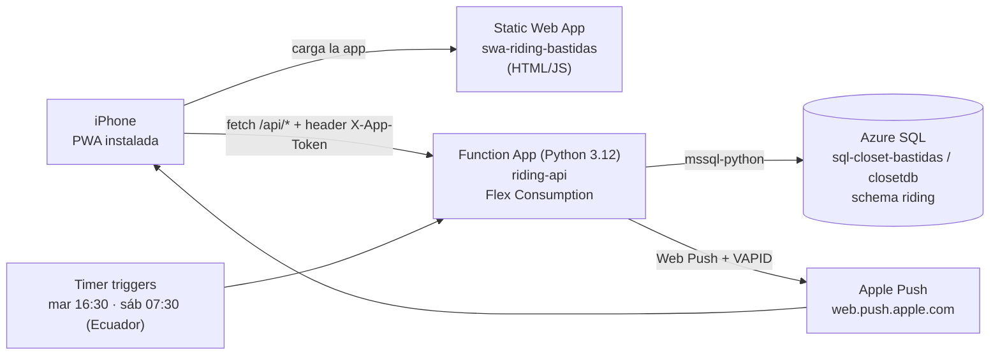

# Equitación · Registro de asistencias

App personal (PWA) para registrar las clases de equitación de mi hija: **8 clases al mes, martes y sábados**, con posibilidad de tomar más. Un clic al llegar registra la clase, un indicador muestra cuántas van de las 8, un calendario mensual muestra el detalle y el total, y un recordatorio por notificación push avisa 30 minutos antes de cada clase (salvo festivos).

Uso personal: sin login. El acceso a la API se protege con un token secreto guardado en el dispositivo.

## Arquitectura



| Componente | Recurso Azure (`rg_bastidas`, East US) | Notas |
|---|---|---|
| Frontend | Static Web App `swa-riding-bastidas` (Free) | Despliegue desde GitHub (`riding-web`), sin build |
| API | Function App `riding-api` (Flex Consumption, Python 3.12, modelo V2) | Storage `stclosetbastidas`, Application Insights `riding-api` |
| Datos | SQL Server `sql-closet-bastidas`, base `closetdb`, schema `riding` | Reutiliza el servidor de otra app; usuario propio con permisos solo sobre el schema |

Zona horaria de negocio: `America/Guayaquil` (UTC-5, sin horario de verano).

## Estructura del repositorio

```
riding-api/
├── function_app.py        # endpoints HTTP + timers (modelo V2)
├── requirements.txt       # azure-functions, mssql-python, tzdata, pywebpush
├── gen_vapid.py           # generador de claves VAPID (ejecutar una vez, local)
└── holidays_seed.sql      # festivos nacionales de Ecuador (resto 2026 y 2027)

riding-web/
├── index.html · style.css · app.js · config.js
├── sw.js                  # service worker: caché + notificaciones push
├── manifest.webmanifest
└── icons/                 # apple-touch-icon, 192, 512
```

## Base de datos

Todo vive en el schema `riding` de `closetdb`.

```sql
CREATE SCHEMA riding;
GO

-- Asistencias (se permiten varias clases el mismo día: sin UNIQUE en class_date)
CREATE TABLE riding.attendance (
    id          INT IDENTITY(1,1) PRIMARY KEY,
    class_date  DATE          NOT NULL,
    note        NVARCHAR(200) NULL,
    created_at  DATETIME2(0)  NOT NULL DEFAULT SYSUTCDATETIME()
);
CREATE INDEX IX_attendance_class_date ON riding.attendance(class_date);
GO

-- Festivos: el recordatorio queda APAGADO por defecto
CREATE TABLE riding.holiday (
    holiday_date      DATE          NOT NULL PRIMARY KEY,
    name              NVARCHAR(100) NOT NULL,
    reminder_enabled  BIT           NOT NULL DEFAULT 0
);
GO

-- Suscripciones Web Push (una por dispositivo)
CREATE TABLE riding.push_subscription (
    id          INT IDENTITY(1,1) PRIMARY KEY,
    endpoint    NVARCHAR(800) NOT NULL UNIQUE,
    p256dh      NVARCHAR(200) NOT NULL,
    auth        NVARCHAR(100) NOT NULL,
    created_at  DATETIME2(0)  NOT NULL DEFAULT SYSUTCDATETIME()
);
GO

-- Usuario exclusivo de la API (contraseña real solo en app settings)
CREATE USER riding_app WITH PASSWORD = '<CONTRASEÑA_FUERTE>', DEFAULT_SCHEMA = riding;
GRANT SELECT, INSERT, UPDATE, DELETE ON SCHEMA::riding TO riding_app;
GO
```

| Tabla | Propósito | Reglas |
|---|---|---|
| `riding.attendance` | Una fila por clase tomada | `class_date` es la fecha local de Guayaquil; `created_at` en UTC. El conteo mensual es `COUNT(*)` por mes calendario |
| `riding.holiday` | Festivos nacionales | Si hoy es festivo y `reminder_enabled = 0`, no se envía recordatorio. Se puede activar por día desde la app |
| `riding.push_subscription` | Dispositivos con notificaciones | `endpoint` único; la API borra e inserta al re-suscribir; se elimina sola si Apple responde 404/410 |

**Datos iniciales (festivos):** `holidays_seed.sql` carga el resto de 2026 y 2027. Fechas tomadas del calendario oficial publicado por el Viceministerio de Turismo (Vistazo y Primicias coinciden); **no incluye feriados locales** (p. ej. Quito, 6 de diciembre). Ecuador traslada algunos feriados por calendario, así que conviene revisarlos cada año.

## API

Todas las rutas exigen el header `X-App-Token`. Sin token válido responde `401` con cuerpo vacío. Si `APP_TOKEN` no está configurada, **nadie** entra.

| Método | Ruta | Descripción |
|---|---|---|
| `GET` | `/api/health` | Verifica token y acceso a SQL |
| `POST` | `/api/attendance` | Registra una clase. Body opcional `{"date":"yyyy-MM-dd","note":"..."}` (por defecto hoy en Guayaquil). Devuelve el resumen del mes y `created_id` |
| `DELETE` | `/api/attendance/{id}` | Elimina un registro (Deshacer). Devuelve el resumen del mes |
| `GET` | `/api/month/{yyyy-MM}` | Resumen: `total`, `target`, `extra`, `days`, `items`, `holidays` |
| `PUT` | `/api/holidays/{yyyy-MM-dd}` | `{"reminder_enabled": true/false}` para un festivo |
| `GET` | `/api/push/config` | Clave pública VAPID |
| `POST` | `/api/push/subscribe` | Guarda la suscripción push del dispositivo |
| `POST` | `/api/push/test` | Envía una notificación de prueba a todos los dispositivos |

**Timers** (hora UTC en el cron; `use_monitor=False` para no disparar avisos atrasados):

| Función | App setting | Valor | Hora Ecuador |
|---|---|---|---|
| `reminder_tuesday` | `REMINDER_TUE_CRON` | `0 30 21 * * 2` | martes 16:30 (clase 17:00) |
| `reminder_saturday` | `REMINDER_SAT_CRON` | `0 30 12 * * 6` | sábado 07:30 (clase 08:00) |

## Configuración

### Function App `riding-api` (Environment variables)

| Nombre | Descripción |
|---|---|
| `SQL_CONNECTION_STRING` | Formato ODBC para `mssql-python`: `Server=sql-closet-bastidas.database.windows.net,1433;Database=closetdb;UID=riding_app;PWD=<...>;Encrypt=yes;TrustServerCertificate=yes` |
| `APP_TOKEN` | Token secreto (`python -c "import secrets; print(secrets.token_urlsafe(32))"`) |
| `VAPID_PRIVATE_KEY` / `VAPID_PUBLIC_KEY` | Generadas con `gen_vapid.py` |
| `VAPID_SUBJECT` | `mailto:<correo de contacto>` (obligatorio el prefijo `mailto:`) |
| `REMINDER_TUE_CRON` / `REMINDER_SAT_CRON` | Ver tabla de timers |
| `MONTHLY_TARGET` | Opcional, meta mensual (por defecto `8`) |

CORS de `riding-api`: solo el dominio de la Static Web App.

### Frontend

`riding-web/config.js` contiene `API_BASE` (URL de la Function App terminada en `/api`).

## Despliegue

1. **SQL:** ejecutar el DDL de arriba y luego `holidays_seed.sql` en `closetdb`.
2. **API:** crear la Function App (Flex Consumption, Python 3.12), cargar las app settings y desplegar `riding-api/` desde VS Code (*Deploy to Function App*).
3. **Web:** subir `riding-web/` a GitHub; la Static Web App (App location `/`, sin build) se publica en cada push a `main`.
4. **CORS:** agregar la URL de la Static Web App en `riding-api`.
5. **iPhone:** abrir la URL en Safari → *Compartir → Añadir a pantalla de inicio* → abrir **desde el ícono**, pegar el token y pulsar *Activar notificaciones*.

## Notas operativas (lecciones aprendidas)

- **Auto-pausa de Azure SQL (free tier):** la primera conexión puede fallar. La API reintenta 4 veces (10 s entre intentos) y el frontend reintenta ante `503`; las escrituras no se reintentan ante errores de red para no duplicar clases.
- **Connection string:** `mssql-python` no acepta `Initial Catalog` ni `Connection Timeout` (formato ADO.NET); usar `Database=` y `UID=`/`PWD=`.
- **Modelo V2 de Functions:** no usar decoradores que inyecten parámetros extra; los handlers reciben solo `req`.
- **iOS:** las notificaciones push solo funcionan con la PWA **instalada** (iOS 16.4+). El `localStorage` de la app instalada es independiente del de Safari, así que el token se pega dentro de la app instalada. `Notification.requestPermission()` debe ejecutarse directamente desde un toque.
- **Web Push:** `pywebpush` modifica el diccionario de `vapid_claims`; se crea uno nuevo por cada envío. La app re-sincroniza la suscripción con el servidor al abrir y antes de la prueba.
- **Seguridad:** el token viaja en un header, nunca en la URL. Si se expone, generar otro, actualizar `APP_TOKEN` y usar *Cambiar token* en la app.

## Pendientes

- Verificar el primer disparo real de los timers (sábado 07:30) en *Functions → Invocations*.
- Rotar el token si ha quedado visible en capturas o chats.
- Actualizar `holiday` cada año (y agregar feriados locales si aplican).
